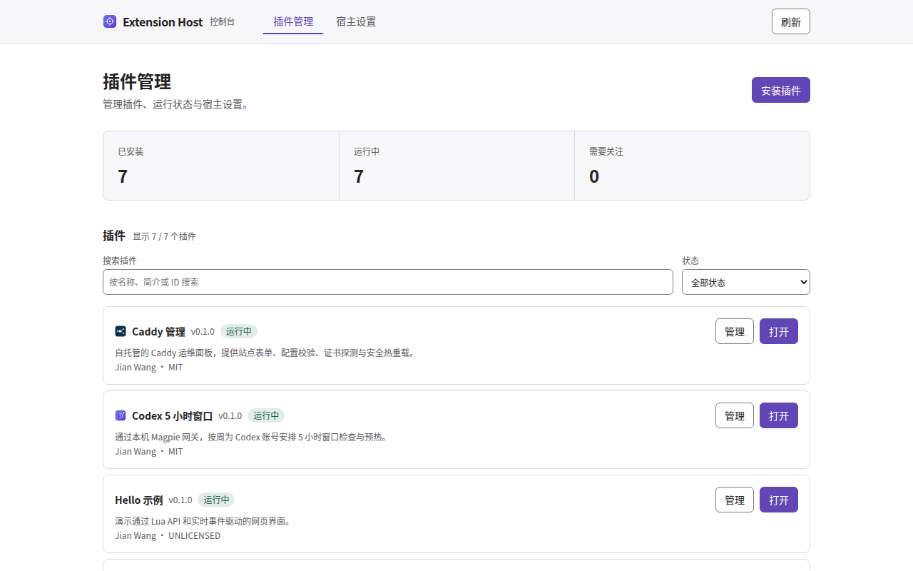

<div align="center">
  
  <h1>Extension Host</h1>
  <p><strong>A lightweight runtime and standalone host for GoDesk extensions.</strong></p>
  <p>One plugin package, two ways to run it: the <code>ext</code> CLI or an embedded Go module.</p>
  <p>
    <a href="https://github.com/EziosWJ/Extension-Host/releases/tag/v0.1"></a>
    <a href="LICENSE"></a>
    <a href="https://github.com/EziosWJ/Extension-Host/releases"></a>
  </p>
  <p>English · <a href="README.zh-CN.md">简体中文</a></p>
</div>



Extension Host installs, enables, runs, and isolates plugins for GoDesk. A plugin can ship a static web page, a Lua backend, or a compiled Linux process, and the same ZIP runs in the standalone `ext` host and inside GoDesk. The host owns lifecycle state, per-plugin SQLite storage, secret configuration, logs, the service API, and schedules.

## Features

- **Web, Lua, and native runtimes** — Serve a static page, run a Lua backend, or supervise a compiled Linux executable. A plugin can combine a web entry with either backend.
- **Isolated plugin data** — Every plugin owns its SQLite business database. Configuration marked `secret` is redacted from management responses and host logs.
- **Service and schedule host APIs** — Lua plugins can query and operate systemd units and register cron or `@every` schedules on the host.
- **Lifecycle management** — Install, enable, start, stop, disable, upgrade, and uninstall plugins. Enabled plugins restart with the host, and business data survives upgrades by default.
- **Dual mode** — Run the standalone `ext` CLI or embed the same `host` Go module in GoDesk. Both use the same manifest, storage layout, and HTTP/WebSocket contract.
- **Developer workflow** — Scaffold a project with `ext init`, reload on save with `ext dev`, check marketplace rules with `ext validate --strict`, package with `ext pkg`, and follow output with `ext logs`.

## Get started

Building requires Linux, Go 1.26, and GNU Make. Native plugins additionally need to be built for `linux-amd64` or `linux-arm64`.

Prebuilt static binaries (SQLite included, no glibc dependency) are attached to each release:

| Architecture | Asset | Typical target |
| --- | --- | --- |
| `linux/amd64` | `ext_<tag>_linux_amd64.tar.gz` | x86-64 servers and NAS |
| `linux/arm64` | `ext_<tag>_linux_arm64.tar.gz` | Raspberry Pi 4/5, ARM64 servers |
| `linux/armv7` | `ext_<tag>_linux_armv7.tar.gz` | 32-bit ARM SBCs and older ARM servers |
| `linux/armv6` | `ext_<tag>_linux_armv6.tar.gz` | Raspberry Pi 1 and Zero |
| `linux/386` | `ext_<tag>_linux_386.tar.gz` | 32-bit x86 |

`SHA256SUMS` covers every asset in the release.

```sh
git clone https://github.com/EziosWJ/Extension-Host.git
cd Extension-Host
make build
make examples
./bin/ext serve --data-dir ./ext-data
```

Open [http://127.0.0.1:5001/host/](http://127.0.0.1:5001/host/) and install `dist/com.example.hello-0.1.0.zip`, then enable it. The example page calls Lua over `fetch`, receives live events over WebSocket, and stores visit counts in its own SQLite database.

To run an example without opening the console first:

```sh
./bin/ext run ./examples/hello --data-dir ./ext-data
```

`ext serve` and `ext run` listen on `127.0.0.1:5001` by default and use `./ext-data`. Change them with `--listen` and `--data-dir`. The console has no login; do not expose it on a public interface without additional access control.

## Developer workflow (`ext` CLI)

| Command | Purpose |
| --- | --- |
| `ext init` | Create a project folder from a template (web, Lua, native, or a combination). |
| `ext dev` | Install and enable the current project; apply changes when files are saved. State lives in `.ext/`. |
| `ext validate [--strict] <dir\|zip>` | Check the manifest, entries, Host API compatibility, and package paths. `--strict` applies marketplace rules. |
| `ext pkg` | Validate the current project and write `dist/<id>-<version>.zip` (native packages add `-<platform>`). |
| `ext pack <dir> [-o file]` | Validate and pack any plugin directory. |
| `ext logs [plugin-id]` | Read `logs/by-plugin/<id>/<version>.log`; supports `--data-dir`, `-n`/`--lines`, and `-f`/`--follow`. |
| `ext run <dir\|zip>` | Install, enable, and serve one plugin. |
| `ext serve` | Start the host and management console. |
| `ext version` / `ext --version` | Print the build version, commit, and build date. |
| `sudo ext setup-sudo` | Install the managed `/etc/sudoers.d/extension-host` rule for the account that runs `ext`, granting it passwordless root. |
| `ext check-sudo` | Probe passwordless root for the current account and report the managed rule's ownership separately. |
| `sudo ext remove-sudo` | Remove the managed rule; succeeds when it is already absent. |

Flags may appear before or after positional arguments. `ext init` generates a project with a `manifest.json`, a `README.md`, and only the runtime files for the chosen template; `backend/`, `go.mod`, and `Makefile` are development-only and stay out of the ZIP.

## Host permissions

The standalone host runs with the OS permissions of the account that starts `ext`, and enabled plugins run with those same permissions ([ADR-0001](docs/adr/0001-trusted-plugins-use-host-account-permissions.md)). The only privileged action is `host.services.start/stop/restart` with `{ sudo = true }`; under a non-root host it runs as `sudo -n -k -u root --`, with no password prompt and no cached credentials.

On Linux with systemd and sudoers, manage the rule that enables this:

```sh
sudo ext setup-sudo   # install /etc/sudoers.d/extension-host for the calling account
ext check-sudo        # probe passwordless root; report rule ownership separately
sudo ext remove-sudo  # remove the managed rule (idempotent)
```

The managed rule grants `NOPASSWD: ALL`, so the host account — and every enabled plugin — can obtain root without a password. Initialize it only on a trusted host, and never expose the console to a public interface without access control. Reading service journal logs additionally requires the host account to be in the `systemd-journal` group, independent of the sudoers rule. Embedded GoDesk deployments keep their own rule (`/etc/sudoers.d/godesk`, `godesk --setup-sudo`). The full contract is in [docs/privileges.md](docs/privileges.md).

## Package and manifest overview

A plugin is a ZIP whose root contains `manifest.json` and at least one of `entry.web`, `entry.lua`, or `entry.native`. Paths stay inside the package root, and the host rejects absolute paths, `..`, backslashes, symlinks, and duplicate entries. The current limits are 64 MiB per file, 256 MiB total, and 4096 files.

```json
{
  "schemaVersion": 1,
  "id": "com.example.hello",
  "name": "Hello Extension",
  "version": "0.1.0",
  "hostApi": { "min": 1, "max": 1 },
  "entry": { "web": "web/index.html", "lua": "lua/init.lua" },
  "license": "MIT"
}
```

Marketplace metadata such as `description`, `author`, `icon`, `categories`, `keywords`, `requirements`, and `locales` is optional for installation and required by `ext validate --strict`. See the [plugin naming and marketplace specification](docs/plugin-naming-and-marketplace-spec.md) and the [native plugin contract](docs/native-plugins.md) for the full field reference.

Management and package errors return a single JSON shape:

```json
{ "code": "invalid_package", "message": "invalid plugin package: manifest.json is missing" }
```

A duplicate install returns `409 already_installed` with `pluginId` so the caller can confirm an upgrade. Other codes include `incompatible_package`, `id_mismatch`, `not_found`, `invalid_lines`, and `log_tail_too_large`.

## Embed in GoDesk

The public `host` package exposes the same engine used by `ext`:

```go
extensionHost, err := host.Open(ctx, host.Options{DataDir: dataDir, Logger: logger})
if err != nil {
    return err
}
if err := extensionHost.Restore(ctx); err != nil {
    logger.Error("restore plugins", "error", err)
}
handler := extensionHost.Handler(host.HTTPOptions{RequireSession: requireSession})
```

`handler` serves the `/api/v1/extensions` management API and the `/extensions/` runtime routes. `RequireSession` wraps every extension route with the embedder's existing operator session. GoDesk keeps its own database, while Extension Host maintains `host.db` and per-plugin databases in its data directory.

## Documentation

- [Extension Host reference](docs/host-reference.md) — CLI, package format, Lua Host API, HTTP routes, lifecycle, and storage (currently in Chinese).
- [Host permissions contract](docs/privileges.md) — runtime identity, managed sudoers rule commands, and security boundaries (currently in Chinese).
- [Native plugin contract](docs/native-plugins.md) — platforms, process protocol, and local Host API.
- [Lua Host API enhancements](docs/lua-host-api-minimal-enhancements.md) — process, filesystem, HTTP, schedule, and event details.
- [Plugin naming and marketplace specification](docs/plugin-naming-and-marketplace-spec.md) — IDs, marketplace metadata, and the static registry schema.
- [Frontend design](docs/frontend-design.md) — host console and plugin frontend baseline.
- [Architecture decisions](docs/adr/) · [GoDesk extension contract](https://github.com/EziosWJ/GoDesk/blob/main/docs/extensions.md)

## Contributing

Issues and suggestions are welcome through [GitHub Issues](https://github.com/EziosWJ/Extension-Host/issues). To work on a change, follow the build instructions above and run the checks:

```sh
make check
make examples
```

## Acknowledgments

Thanks to the authors and contributors of the open source projects that make Extension Host possible, including [Go](https://go.dev/), [GopherLua](https://github.com/yuin/gopher-lua), [modernc.org/sqlite](https://modernc.org/sqlite), [robfig/cron](https://github.com/robfig/cron), [coder/websocket](https://github.com/coder/websocket), and [GoDesk](https://github.com/EziosWJ/GoDesk), as well as all other direct and indirect dependencies.

## License

[Apache License 2.0](LICENSE).
