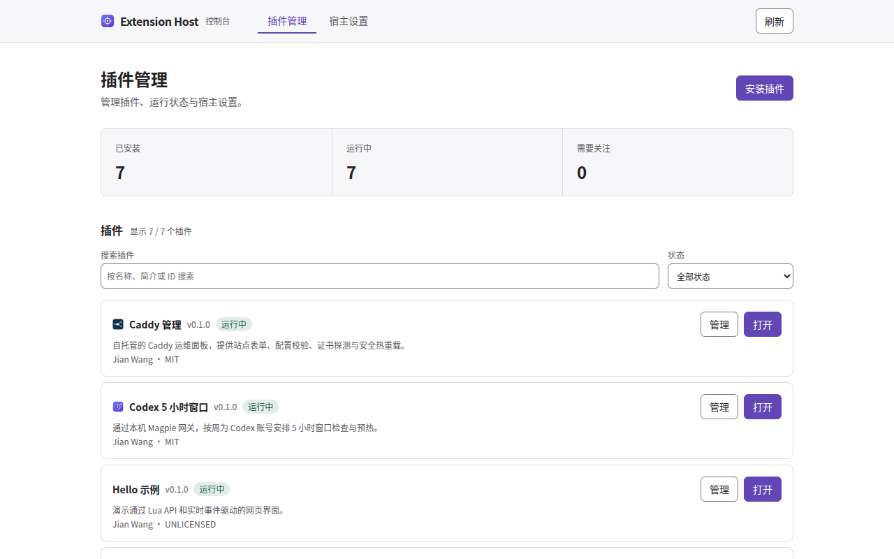

<div align="center">
  
  <h1>Extension Host</h1>
  <p><strong>面向 GoDesk 插件的轻量运行时与独立宿主。</strong></p>
  <p>同一个插件包，两种运行方式：<code>ext</code> 命令行或可嵌入的 Go 模块。</p>
  <p>
    <a href="https://github.com/EziosWJ/Extension-Host/releases/tag/v0.1"></a>
    <a href="LICENSE"></a>
    <a href="https://github.com/EziosWJ/Extension-Host/releases"></a>
  </p>
  <p><a href="README.md">English</a> · 简体中文</p>
</div>



Extension Host 负责安装、启用、运行和隔离 GoDesk 插件。插件可以交付静态网页、Lua 后端或编译后的 Linux 进程，同一个 ZIP 既能运行在独立 `ext` 宿主中，也能运行在 GoDesk 内。宿主统一管理生命周期状态、插件专属 SQLite 存储、密钥配置、日志、服务接口和定时任务。

## 功能

- **Web、Lua 与原生运行时**：提供静态页面、运行 Lua 后端，或托管编译后的 Linux 可执行文件。插件可以把网页入口与任一后端组合使用。
- **隔离的插件数据**：每个插件拥有自己的 SQLite 业务数据库。标记为 `secret` 的配置不会出现在管理响应和宿主日志中。
- **服务与定时任务宿主 API**：Lua 插件可以查询和操作 systemd 服务，并按 cron 或 `@every` 表达式注册定时任务。
- **生命周期管理**：安装、启用、启动、停止、禁用、升级和卸载插件。已启用插件随宿主恢复，升级默认保留业务数据。
- **双模式运行**：既能使用独立 `ext` 命令行，也能在 GoDesk 中嵌入同一个 `host` Go 模块。两种模式共用 Manifest、存储布局和 HTTP/WebSocket 契约。
- **开发工作流**：用 `ext init` 创建项目，`ext dev` 保存即更新，`ext validate --strict` 检查市场准入规则，`ext pkg` 打包，`ext logs` 查看输出。

## 快速开始

构建需要 Linux、Go 1.26 和 GNU Make。原生插件还需面向 `linux-amd64` 或 `linux-arm64` 构建。

每个 Release 都附带静态二进制（内嵌 SQLite，不依赖 glibc）：

| 架构 | 产物 | 适用设备 |
| --- | --- | --- |
| `linux/amd64` | `ext_<tag>_linux_amd64.tar.gz` | x86-64 服务器与 NAS |
| `linux/arm64` | `ext_<tag>_linux_arm64.tar.gz` | 树莓派 4/5、ARM64 服务器 |
| `linux/armv7` | `ext_<tag>_linux_armv7.tar.gz` | 32 位 ARM SBC、老式 ARM 服务器 |
| `linux/armv6` | `ext_<tag>_linux_armv6.tar.gz` | 树莓派 1 与 Zero |
| `linux/386` | `ext_<tag>_linux_386.tar.gz` | 32 位 x86 |
| `linux/riscv64` | `ext_<tag>_linux_riscv64.tar.gz` | RISC-V 开发板与服务器 |
| `linux/loong64` | `ext_<tag>_linux_loong64.tar.gz` | 龙芯 3A5000/3A6000 |

`SHA256SUMS` 覆盖该 Release 的全部产物。

```sh
git clone https://github.com/EziosWJ/Extension-Host.git
cd Extension-Host
make build
make examples
./bin/ext serve --data-dir ./ext-data
```

打开 [http://127.0.0.1:5001/host/](http://127.0.0.1:5001/host/)，安装 `dist/com.example.hello-0.1.0.zip` 并启用。示例页面通过 `fetch` 调用 Lua，通过 WebSocket 接收实时事件，并把访问次数写入自己的 SQLite。

也可以先直接运行示例：

```sh
./bin/ext run ./examples/hello --data-dir ./ext-data
```

`ext serve` 和 `ext run` 默认监听 `127.0.0.1:5001`，数据目录为 `./ext-data`，可用 `--listen` 和 `--data-dir` 调整。管理控制台没有登录；不要在没有额外访问控制的情况下把它绑定到公网接口。

## 开发工作流（`ext` 命令行）

| 命令 | 用途 |
| --- | --- |
| `ext init` | 从模板创建项目文件夹（网页、Lua、原生或组合模板）。 |
| `ext dev` | 安装并启用当前项目，保存文件后自动更新。状态位于 `.ext/`。 |
| `ext validate [--strict] <dir\|zip>` | 校验 Manifest、入口、Host API 兼容性和包路径。`--strict` 执行市场准入校验。 |
| `ext pkg` | 校验当前项目并生成 `dist/<id>-<version>.zip`（原生包附加 `-<platform>`）。 |
| `ext pack <dir> [-o file]` | 校验并打包任意插件目录。 |
| `ext logs [plugin-id]` | 读取 `logs/by-plugin/<id>/<version>.log`，支持 `--data-dir`、`-n`/`--lines` 和 `-f`/`--follow`。 |
| `ext run <dir\|zip>` | 安装、启用并运行一个插件。 |
| `ext serve` | 启动宿主和管理控制台。 |
| `ext version` / `ext --version` | 输出构建版本、提交和构建时间。 |
| `sudo ext setup-sudo` | 为运行 `ext` 的账号安装托管规则 `/etc/sudoers.d/extension-host`，授予其免密 root。 |
| `ext check-sudo` | 以当前账号探测免密 root 是否可用，并单独报告托管规则的归属状态。 |
| `sudo ext remove-sudo` | 移除托管规则；规则不存在时幂等成功。 |

参数可以放在位置参数前后。`ext init` 生成的项目包含 `manifest.json`、`README.md` 和所选模板的运行文件；`backend/`、`go.mod` 和 `Makefile` 仅用于开发，不进入 ZIP。

## 主机权限

独立宿主以启动 `ext` 的 Linux 账号权限运行，已启用插件继承同一权限（[ADR-0001](docs/adr/0001-trusted-plugins-use-host-account-permissions.md)）。唯一需要提权的操作是 `host.services.start/stop/restart` 传入 `{ sudo = true }`；非 root 宿主通过 `sudo -n -k -u root --` 执行，不提示密码，也不复用缓存凭据。

在 Linux + systemd + sudoers 环境下，用以下命令管理授权规则：

```sh
sudo ext setup-sudo   # 为当前账号安装 /etc/sudoers.d/extension-host
ext check-sudo        # 探测免密 root，并单独报告规则归属
sudo ext remove-sudo  # 移除托管规则（幂等）
```

托管规则授予 `NOPASSWD: ALL`，意味着宿主账号（含全部已启用插件）可无密码取得 root。只应在受信任的主机上初始化，并且不要把未加访问控制的管理控制台暴露到公网。读取服务 journal 日志还要求宿主账号加入 `systemd-journal` 组，与 sudoers 规则相互独立。嵌入 GoDesk 时仍沿用其自有规则（`/etc/sudoers.d/godesk`、`godesk --setup-sudo`）。完整契约见 [docs/privileges.md](docs/privileges.md)。

## 插件包与 Manifest 概览

插件是一个 ZIP，根目录必须包含 `manifest.json`，并至少声明 `entry.web`、`entry.lua` 或 `entry.native` 之一。包内路径必须留在包根目录内，宿主会拒绝绝对路径、`..`、反斜杠、符号链接和重复条目。当前限制为单文件 64 MiB、总计 256 MiB、最多 4096 个文件。

```json
{
  "schemaVersion": 1,
  "id": "com.example.hello",
  "name": "Hello Extension",
  "version": "0.1.0",
  "hostApi": { "min": 1, "max": 1 },
  "entry": { "web": "web/index.html", "lua": "lua/init.lua" },
  "license": "MIT"
}
```

`description`、`author`、`icon`、`categories`、`keywords`、`requirements` 和 `locales` 等市场元数据在安装时可选，`ext validate --strict` 会要求补齐。完整字段见[插件命名规范与市场化准备 Spec](docs/plugin-naming-and-marketplace-spec.md)和[原生可执行插件首版契约](docs/native-plugins.md)。

管理接口和包错误使用统一的 JSON 结构：

```json
{ "code": "invalid_package", "message": "invalid plugin package: manifest.json is missing" }
```

重复安装返回 `409 already_installed` 并附带 `pluginId`，调用方确认后可提交升级。其他错误码包括 `incompatible_package`、`id_mismatch`、`not_found`、`invalid_lines` 和 `log_tail_too_large`。

## 嵌入 GoDesk

公共 `host` 包提供与 `ext` 相同的引擎：

```go
extensionHost, err := host.Open(ctx, host.Options{DataDir: dataDir, Logger: logger})
if err != nil {
    return err
}
if err := extensionHost.Restore(ctx); err != nil {
    logger.Error("restore plugins", "error", err)
}
handler := extensionHost.Handler(host.HTTPOptions{RequireSession: requireSession})
```

`handler` 同时提供 `/api/v1/extensions` 管理 API 和 `/extensions/` 运行路由。`RequireSession` 会使用嵌入方已有的操作者会话包裹全部扩展路由。GoDesk 继续使用自己的数据库，Extension Host 在自己的数据目录维护 `host.db` 和插件业务库。

## 文档

- [Extension Host 参考手册](docs/host-reference.md)：命令行、包格式、Lua Host API、HTTP 路由、生命周期与存储。
- [主机权限契约](docs/privileges.md)：运行身份、托管 sudoers 规则命令与安全边界。
- [原生可执行插件契约](docs/native-plugins.md)：平台、进程协议与本地 Host API。
- [Lua Host API 增补说明](docs/lua-host-api-minimal-enhancements.md)：进程、文件系统、HTTP、定时任务与事件细节。
- [插件命名规范与市场化准备 Spec](docs/plugin-naming-and-marketplace-spec.md)：ID、市场元数据与静态 Registry 契约。
- [前端设计](docs/frontend-design.md)：宿主管理页与插件前端设计基线。
- [架构决策](docs/adr/) · [GoDesk 插件契约](https://github.com/EziosWJ/GoDesk/blob/main/docs/extensions.md)

## 参与贡献

欢迎通过 [GitHub Issues](https://github.com/EziosWJ/Extension-Host/issues) 反馈问题和提出建议。参与开发时，请参考上方的构建说明并运行检查：

```sh
make check
make examples
```

## 致谢

感谢所有让 Extension Host 成为可能的开源项目及其贡献者，包括 [Go](https://go.dev/)、[GopherLua](https://github.com/yuin/gopher-lua)、[modernc.org/sqlite](https://modernc.org/sqlite)、[robfig/cron](https://github.com/robfig/cron)、[coder/websocket](https://github.com/coder/websocket) 和 [GoDesk](https://github.com/EziosWJ/GoDesk)，以及其他所有直接和间接依赖。

## 许可证

[Apache License 2.0](LICENSE)。
